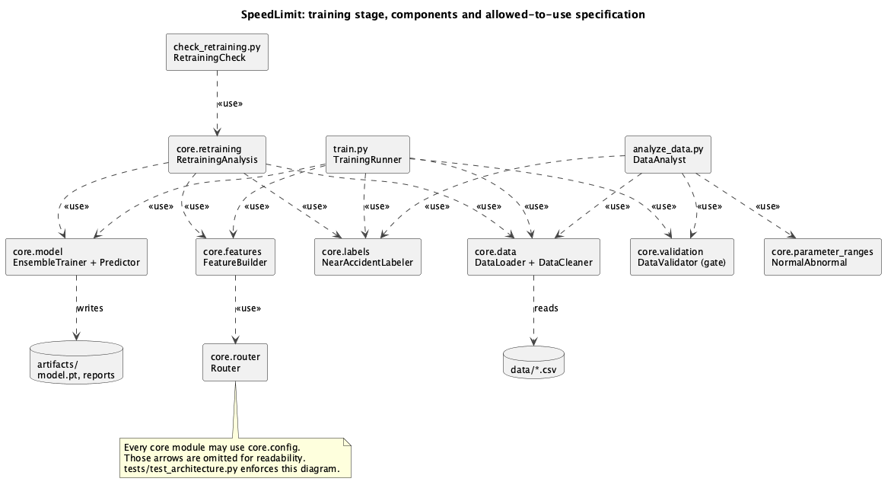
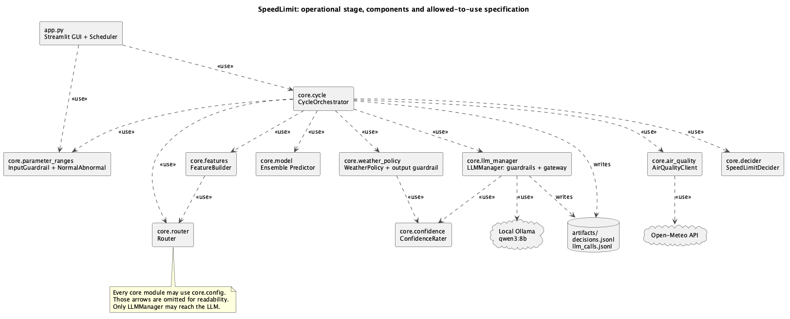
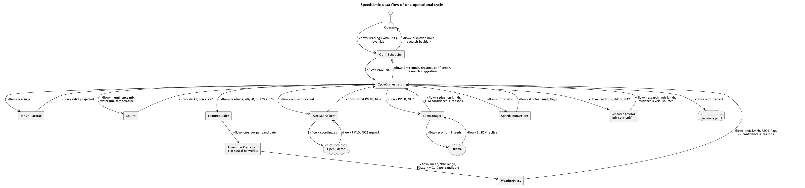
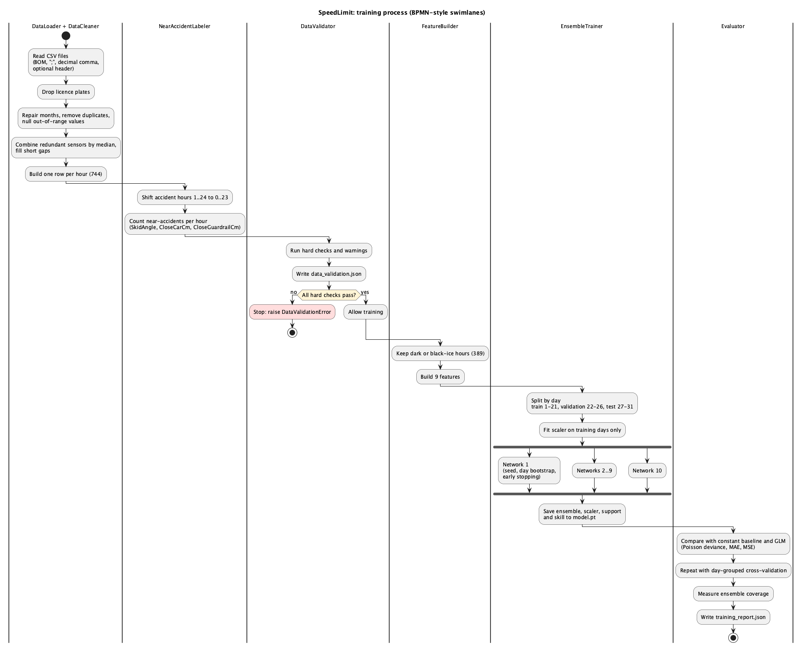
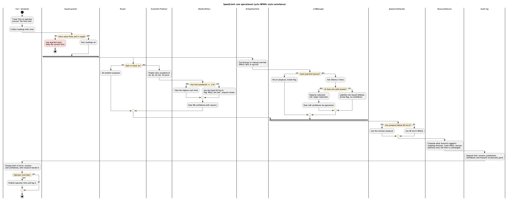
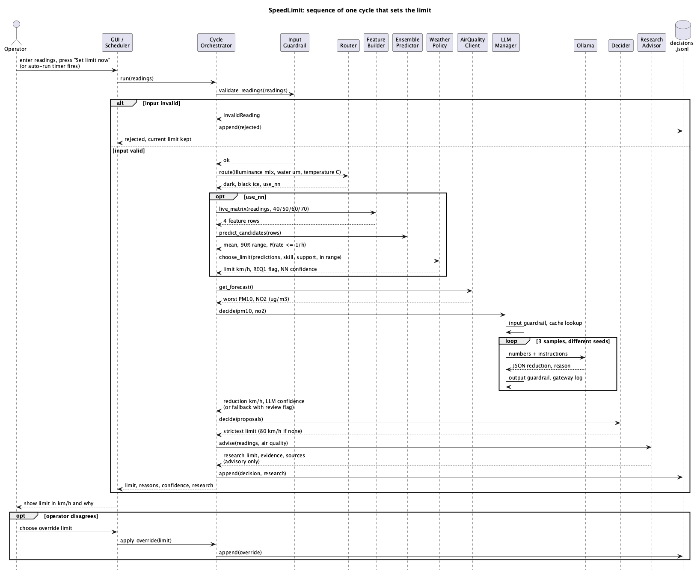
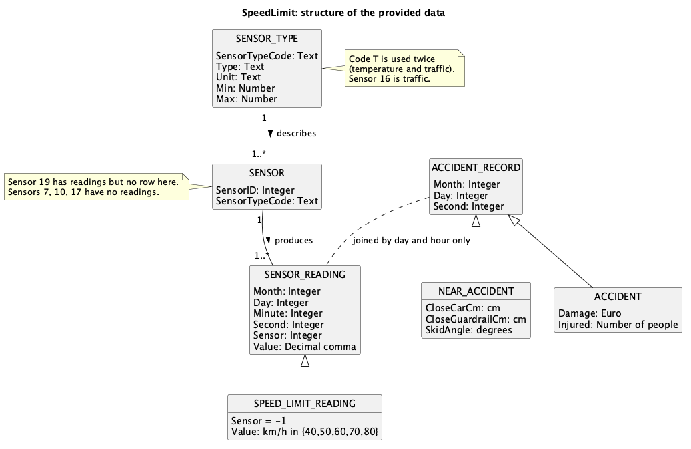

# Architecture and design decisions

This document explains how SpeedLimit is built and why. Results that depend on running the code are in [Results](#results).

## 1. The problem

The highway operator wants the limit set automatically:

| ID | Rule |
|---|---|
| REQ1 | When dark or black-ice danger exists, reduce the limit so that near-accidents average at most 1 per hour |
| REQ2 | When poor air quality is predicted, reduce the limit appropriately. An LLM decides, using an air-quality API |
| REQ3 | With no reason to reduce, the limit is 80 km/h |
| SPEC1 | Dark means illuminance below 500 millilux |
| SPEC2 | Black-ice danger means more than 1000 µm of water and a temperature below 0 °C |
| SPEC3 | A neural network learns how weather, the current limit and near-accidents are connected |
| SPEC4 | A near-accident is skidding or coming too close to another car or the guardrail |

## 2. Architecture

An architecture is its components plus the allowed-to-use specification. Both are shown below and enforced by `tests/test_architecture.py`.

| Component | Module | Responsibility in one sentence |
|---|---|---|
| Configuration | `core/config.py` | Holds thresholds, sensor mappings, allowed limits and paths in one place |
| DataLoader + DataCleaner | `core/data.py` | Reads the raw files and produces one clean row per hour with a report of every repair |
| DataValidator | `core/validation.py` | Decides whether the cleaned table is fit for training |
| NearAccidentLabeler | `core/labels.py` | Counts near-accidents per hour according to SPEC4 |
| FeatureBuilder | `core/features.py` | Builds identical model inputs for training and live use |
| EnsembleTrainer + Predictor | `core/model.py` | Trains 10 small networks, evaluates them and predicts near-accidents per hour |
| ConfidenceRater | `core/confidence.py` | Turns measurable checks into a confidence level and plain-language reasons |
| Router | `core/router.py` | Decides whether darkness or black ice applies |
| InputGuardrail + NormalAbnormal | `core/parameter_ranges.py` | Rejects impossible inputs and classifies each value as Normal or Abnormal |
| WeatherPolicy | `core/weather_policy.py` | Turns candidate predictions into a limit and checks that the output is legal |
| AirQualityClient | `core/air_quality.py` | Fetches the worst forecast PM10 and NO₂ of the coming hours |
| LLMManager | `core/llm_manager.py` | Wraps the LLM with input and output guardrails, repeated sampling and a call log |
| SpeedLimitDecider | `core/decider.py` | Picks the strictest proposal, otherwise 80 km/h |
| CycleOrchestrator | `core/cycle.py` | Runs one full decision in fixed order and writes the audit record |
| GUI + Scheduler | `app.py` | Lets the operator enter readings, run on a timer, see reasons and override |
| RetrainingAnalysis | `core/retraining.py` | Compares Year N+1 with the trained model and recommends what to do |
| ResearchAdvisor | `core/research_advisor.py` | Shows what published research suggests beside the system limit, as explicit cited formulas, and never sets the limit |
| SyntheticDataExperiment | `synthetic_experiment.py` | Tests whether generated data improves the model on real held-out days, without changing the production model |

### How the components cooperate

The GUI or its timer hands readings to the CycleOrchestrator. The InputGuardrail rejects impossible values, and a rejected cycle keeps the current limit. The Router applies SPEC1 and SPEC2. Only if one of them holds does the FeatureBuilder create one row per candidate limit for the ensemble, and the WeatherPolicy turns the predictions into a limit. Independently, the AirQualityClient fetches a forecast and the LLMManager asks the LLM for a reduction. The Decider takes the strictest proposal, or 80 km/h if there is none. The result and its reasons go to the audit log and the screen.

The orchestration is static. The programmer fixed the steps at design time, and the network and the LLM only supply values. A safety-related decision should not depend on an agent choosing its own next step.

### Process design

The lecture recommends BPMN for describing processes. PlantUML has no BPMN notation, so these are swimlane activity diagrams using the same ideas (the "Almost BPMN" style from the lecture):

| BPMN element | In these diagrams |
|---|---|
| Pool or lane | Swimlane named after the component |
| Exclusive gateway | Yellow diamond |
| Parallel gateway | Fork and end fork bar |
| Task | Rounded box |
| Start and end events | Black circle and bullseye |

### Data model

Accidents have no link to sensors. They are joined by day and hour only, which is why the hour shift in the labeler matters.

## 3. Why these choices

| Choice | Reason |
|---|---|
| Router and Decider are plain code | SPEC1, SPEC2 and REQ3 are exact rules. A model would add risk and no value, and plain code can be tested exhaustively at its boundaries |
| Static orchestration | The order of steps is known. Fixed steps are testable and auditable |
| Validation gate before training | A model cannot be better than its data. The gate makes "the data is fit for use" a checked fact and stops training otherwise |
| Median of redundant sensors | One faulty sensor cannot change the value. It also absorbs the outliers described on slide 17 |
| Train only on dark or black-ice hours | The network is used only there, so that is the population it should learn |
| Poisson loss with a log-rate output | The target is a count per hour. Poisson loss matches that, and the log output keeps predictions positive |
| Small network (9→16→8→1) | 389 rows cannot support anything large |
| Split by day | Hours of the same day are related. Splitting by day stops the same day leaking into training and test |
| Repeated cross-validation | With one small test set, a good or bad score can be luck |
| Constant baseline and GLM | A loss value means nothing alone. The network has to beat guessing the average |
| Control experiment in the tests | Planted-signal data separates "the code is broken" from "the data has nothing to say" |
| Features left out | Minute and second are noise. Noise (dB) follows traffic. Wind direction is circular and meaningless without wind. Licence plates are personal data |
| Candidates 40 to 70 km/h | 80 km/h never occurs in dark or black-ice hours, so asking about it would be pure extrapolation |
| PyTorch | The network, the loss and the training loop are explicit and can be explained line by line |
| Streamlit | The GUI is short Python, which suits an MVP. It is bound to localhost |
| Research as explicit cited formulas | Outside knowledge stays visible, checkable and separate from what the system learned (section 10) |
| Local Ollama (`qwen3:8b`) | Already installed, free, no account, and no data leaves the machine |
| Open-Meteo | The assignment requires an API. It needs no account, and only fixed Vienna coordinates are sent |
| Guardrails around both AI parts | The lecture is clear that AI output cannot go straight to the user. Output must be one of a small set of legal values |
| LLM prompt contains only numbers | Nothing from outside can be injected into the instructions |
| Human in the loop | The operator sees flags and can override at any time, because software guardrails cannot be fully trusted |
| Append-only decision log | Every published limit can be reconstructed afterwards |

## 4. What happens when REQ1 cannot be met

When no candidate limit is predicted at or below 1 near-accident per hour, the policy uses a **fixed 60 km/h**, shows "REQ1 not met", requests operator review and logs it. 60 km/h is the limit with the most evidence in dark or black-ice hours (230 hours).

**Why not the limit with the lowest prediction.** That was the first design, and replaying the data showed the problem. In the training data, lower limits coincide with more near-accidents (40 km/h: 1.86 per hour, 70 km/h: 1.13 per hour). This is noise or confounding, but the network learned it, so the rule chose 70 km/h in all 389 dark or black-ice hours, including icy nights. The project owner reviewed that result and chose the fixed limit instead.

**Why not 40 km/h.** It would be the strictest choice, but there are only 7 hours of evidence at 40 km/h, and the data does not show that it helps.

**The trade-off.** On this data the network never finds a limit that meets REQ1, so the fixed limit applies in every dark or black-ice hour. The network therefore does not change the outcome yet. It stays in the design so that it can take over if better data gives it real predictive skill. Until then, 60 km/h is a cautious default and not a proven safe limit, which is why an operator is asked to review it.

If the network itself is unavailable, the cycle uses the same fixed 60 km/h and also sets a review flag.

## 5. Confidence levels

Every neural-network and LLM result shows a level and the reasons for it. The Router and the Decider are deterministic, so they are labelled "rule, not a prediction".

### Neural network

Ten networks are trained with different seeds and on bootstrapped days. Their mean is the prediction. Their spread shows how much they disagree. For each candidate limit the GUI shows the predicted near-accidents per hour, the 90% range across networks, and the share of networks that put the rate at or below 1 per hour.

The overall level is the lowest result of four checks:

| Check | High | Medium | Low |
|---|---|---|---|
| Cross-validated skill vs. constant baseline | at least +5% | +2% up to +5% | below +2% |
| Ensemble agreement: width of 90% range divided by mean | up to 0.25 | up to 0.50 | above 0.50 |
| Training hours at the chosen limit | at least 100 | 30 to 99 | below 30 |
| Inputs inside the training range | yes | | no |

A skill below +2% counts as no skill, because cross-validation folds differ from each other by several points.

**Why the minimum:** agreement between networks does not help if the networks never beat guessing. A level has to be earned on every check. Ensembles can also agree while being wrong, so skill measured on held-out days is the check that caps the rest.

**Why it says rate and not hour:** near-accidents are random even when the true rate is known. The ensemble describes uncertainty about the rate. It cannot say how many near-accidents one particular hour will have.

### LLM

Each decision asks the local model 3 times with different seeds. The majority answer is used, and a tie takes the larger reduction.

| Valid answers that agree | Level |
|---|---|
| 3 of 3 | High |
| 2 of 3 | Medium |
| No majority | Low |
| No usable answer, rule-based fallback used | No confidence |

**Why not ask the LLM how sure it is:** an LLM's statement about its own confidence is not calibrated. Agreement across repeated answers can be measured. It shows consistency and not correctness, and the GUI says so.

## 6. Why the network has no skill

Three independent observations point to the data and not to the code:

1. Hourly near-accident counts have variance/mean = 1.00, which is what pure Poisson randomness looks like.
2. Year N and Year N+1 have identical sensor inputs hour by hour, yet their near-accident counts in dark or black-ice hours do not correlate (r = 0.003). If conditions drove the counts, identical conditions would give similar counts.
3. A linear model and gradient boosting do no better than a constant, so this is not specific to neural networks.

The control experiment in `tests/test_model.py` shows that the same pipeline learns when a real signal exists.

## 7. Requirements traceability

| Requirement | Components | Tests |
|---|---|---|
| REQ1 | Router, FeatureBuilder, Predictor, WeatherPolicy | `test_router.py`, `test_features.py`, `test_model.py`, `test_weather_policy.py` |
| REQ2 | AirQualityClient, LLMManager | `test_air_quality.py`, `test_llm_manager.py` |
| REQ3 | SpeedLimitDecider | `test_decider.py` |
| SPEC1, SPEC2 | Router, NormalAbnormal | `test_router.py`, `test_parameter_ranges.py` |
| SPEC3 | Trainer, Predictor | `test_model.py` |
| SPEC4 | NearAccidentLabeler | `test_labels.py` |
| Data fit for use | DataCleaner, DataValidator | `test_data.py`, `test_validation.py` |
| Regular operation | CycleOrchestrator, GUI | `test_cycle.py`, `test_app.py` |
| Confidence shown | ConfidenceRater, WeatherPolicy, LLMManager | `test_confidence.py`, `test_cycle.py` |
| Research shown beside the decision | ResearchAdvisor | `test_research_advisor.py`, `test_cycle.py`, `test_app.py` |
| Retraining decision | RetrainingAnalysis | `test_retraining.py` |
| Allowed-to-use | All | `test_architecture.py` |

## 8. Assumptions

- Accident hours 1 to 24 correspond to sensor hours 0 to 23. The results are the same with other alignments.
- Sensor 16 is traffic, and sensor 19 is a temperature sensor.
- The wind unit `hm/h` in `SensorTypes` is a typo for km/h.
- Near-accidents are recorded reliably, and real accidents (Damage or Injured) do not count as near-accidents, following SPEC4.
- January is treated as representative, though it may well not be.
- "Predicted" air quality in REQ2 uses the worst value in the next hours of the forecast.
- The PM10 limit of 50 µg/m³ and the NO₂ limit of 200 µg/m³ come from EU Directive 2008/50/EC.

## 9. Change requests (SpeedLimit21)

| Change | What changes | Why that little |
|---|---|---|
| Some temperature sensors return Fahrenheit | Sensor mapping in `config.py` and a conversion in `data.py`; retrain if the training data changes | Only the cleaner knows raw units. Everything after it sees °C |
| Only skidding counts as a near-accident | Call the labeler with `kinds=("SkidAngle",)`, then validate and retrain | The label definition is in one place |
| Electric cars are exempt from air-quality limits | The Decider must return two limits, and the cycle, GUI and log must carry both, plus signs that can show two limits | The biggest change: "one limit for everyone" is an architectural assumption |

## 10. What research suggests (advisory panel)

Beside the system's decision, the GUI shows what published research suggests for the same conditions. It never sets the published limit. The evidence behind every number, with its read-status and conflicts, is in [the research report](../reports/Speed%20limit%20advisor%20evidence.md).

**Why explicit formulas and not a second neural network.** A network trained on published figures would hide outside assumptions inside its weights and look as if it had learned them from this road. The synthetic data experiment showed where that leads. The advisor writes each assumption down as a named parameter in `core/config.py`, with its source.

**How it decides**

1. The surface comes from the same rules as the Router: black ice under SPEC2, wet if there is any water, otherwise dry.
2. The available distance is 91 m in darkness (AAA 2015, halogen low beam, an upper bound) and 128 m in daylight (AASHTO stopping distance at 80 km/h, used as a proxy for the road's design).
3. Stopping distance = reaction distance at 2.5 s + braking distance with friction 0.8 (dry), 0.7 (wet) or 0.15 (black ice), from VTI 911A.
4. The suggestion is the highest allowed limit that stops within the available distance.
5. For each limit, the expected change in injury crashes and deaths uses Elvik's Exponential Model (β 0.034 and 0.065), with one quarter of a posted cut reaching mean speed (Elvik et al. 2004). The range shown runs from the weakest published case (compliance 0.17) to the strongest (compliance 0.55 with the higher 2019 coefficients).

| Conditions | Research suggests | Main reason |
|---|---|---|
| Daylight, dry or wet | 80 km/h | Stops well within the design distance |
| Darkness, dry | 80 km/h | 87 m stopping distance fits within 91 m; darkness alone has the weakest evidence |
| Darkness, wet | 70 km/h | 80 km/h needs 91.5 m |
| Black ice, daylight | 50 km/h | 60 km/h needs 136 m against 128 m available |
| Black ice, darkness | 40 km/h | 50 km/h needs 100 m against 91 m available |
| Poor air quality alone | 80 km/h | No published evaluation of cuts below 80 km/h on a free-flowing road |

**Evidence levels.** These are shown instead of a single confidence:

| Part | High | Medium | Low |
|---|---|---|---|
| Stopping-distance check | Daylight on a dry or wet road | Black ice; darkness on a wet road | Darkness alone |
| Crash-effect estimate | n/a | Suggested limit of 70 km/h | 60 km/h or lower, which is outside most studies |
| Air quality | n/a | n/a | Always, when the EU limit is exceeded |

When the suggestion is 80 km/h, the crash-effect estimate is shown as not applicable.

**What it cannot do.** It does not predict near-accidents, because no published model links speed to them. So it cannot say whether REQ1 is met. Its crash figures are network-average calculations for free-flowing traffic, not forecasts for this road. The injury coefficient is disputed (0.034 or 0.06), and no compliance value has been published for advisory signs.

## Results

Measured on the real data with the committed model. Reports are in `artifacts/`.

### Data

The cleaned table passes every hard validation check: 744 complete hours, no missing or out-of-range values, labels reconciled with the source (964 near-accidents), and redundant sensors agreeing (lowest correlation 0.995). See [DATA_QUALITY.md](DATA_QUALITY.md).

### Neural network

| Measure, 389 dark or black-ice hours | Network | Constant baseline | GLM |
|---|---|---|---|
| Poisson deviance on test days 27 to 31 | 0.982 | 0.999 | 0.978 |

| Measure | Value |
|---|---|
| Skill on the single test split | +1.7% |
| **Cross-validated skill, 20 folds grouped by day** | **+0.4%** (best fold +4.7%, worst -3.2%) |
| Best epoch per network | 1 to 8, because validation loss stops improving almost at once |
| Predictions on test days | Only 1.18 to 1.36 near-accidents/h |
| 90% predictive coverage on test days | 97%, somewhat wider than necessary |

The +1.7% on one split shows why a single split cannot be trusted. Across 20 folds the result is within noise, so the system treats it as no skill and caps confidence at Low. The network also scores a little worse than the simple GLM on the test split.

The control experiment in `tests/test_model.py` confirms that the same code learns when a real signal exists.

### What the policy does

Replaying all 389 dark or black-ice hours of Year N:

| Result | Value |
|---|---|
| Hours where a limit met REQ1 (at most 1 predicted near-accident/h) | **0 of 389** |
| Limit used | **Fixed 60 km/h in all 389 hours** |
| Neural-network confidence | Low in all 389 hours |

No hour meets REQ1, so the weather path always reduces the limit by 20 km/h and always asks for operator review. An earlier rule that took the limit with the lowest prediction chose 70 km/h in all 389 hours, which is why it was replaced (see section 4).

### LLM

The local model stayed within the expected ranges in all 5 golden test cases. For PM10 120 and NO₂ 250 µg/m³, all 3 samples chose a 30 km/h reduction. For the live forecast of PM10 35.2 and NO₂ 18.3 µg/m³, all 3 chose no reduction.

### Retraining

| Check | Result |
|---|---|
| Sensor inputs Year N+1 vs. Year N | Identical (largest KS statistic 0.0) |
| Near-accidents | 964 to 822, down 15% (p = 0.0008) |
| Year N model on Year N+1 | Skill -0.5% against the Year N average |
| Model retrained on Year N+1 | Cross-validated skill -1.1% |

**Decision: do not retrain yet. Clarify the data first.** A full year of sensor readings cannot be identical to the previous one, so the file may be a copy. If it is genuine, retraining would adjust only the base rate and add no predictive skill.

### Synthetic data

Generating more data does not help. Data imitating the real data, up to 20 times as much, stays within noise on real held-out days. Data with an assumed effect of speed teaches the model that assumption: "faster is riskier" and "slower is riskier" both claim to satisfy REQ1, while recommending opposite limits and losing to guessing the average on real days. See [SYNTHETIC_DATA.md](SYNTHETIC_DATA.md).

### What should change before real use

1. Find out why the Year N+1 sensor file is identical to Year N.
2. Collect data for a full year and more road sections.
3. Vary limits in a controlled trial, so cause and effect can be separated.
4. Measure near-accidents per 1000 cars instead of raw counts.
5. Have road-safety experts confirm or replace the fixed 60 km/h.
