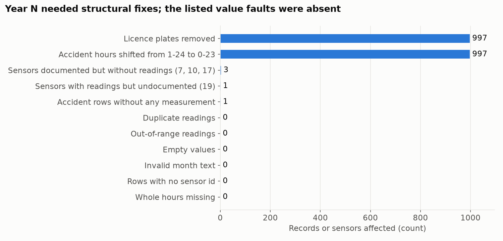
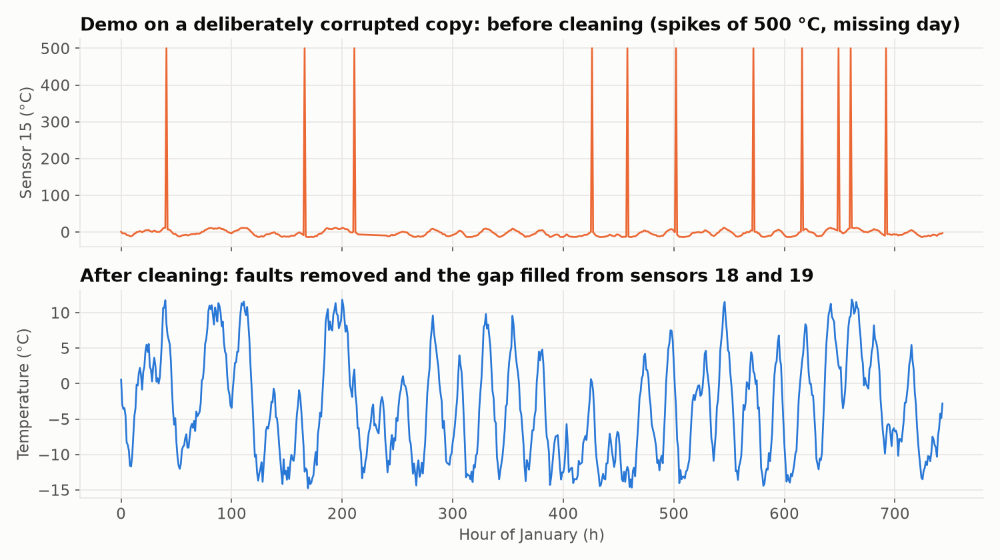
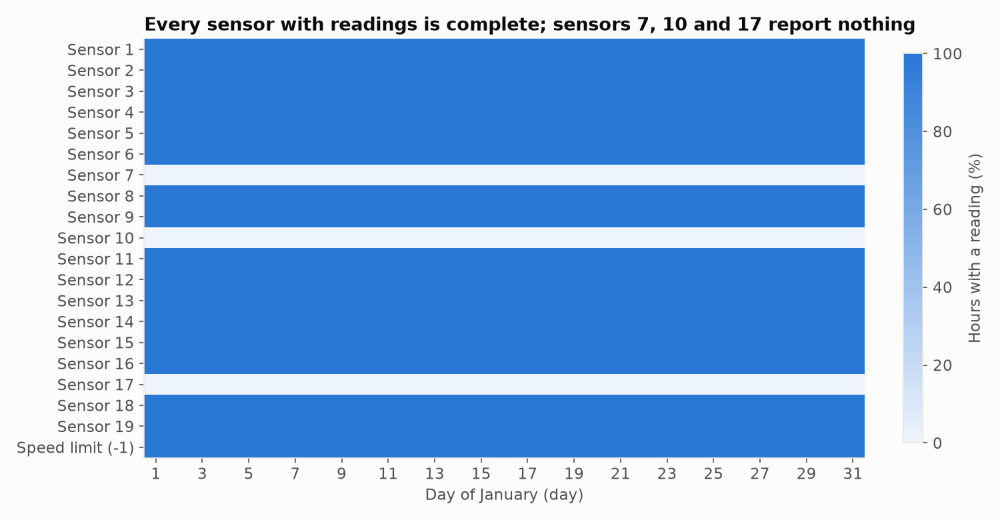
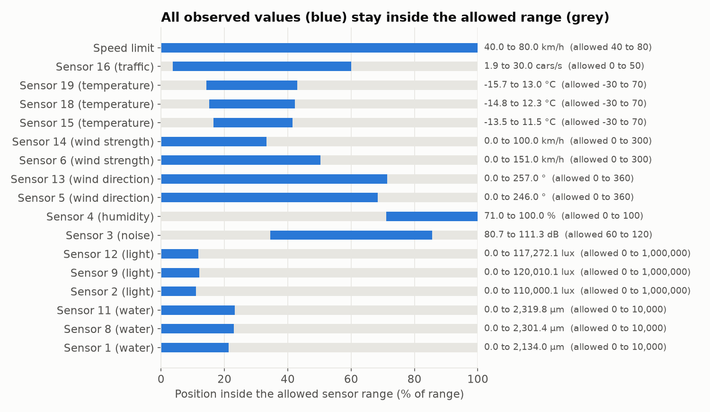
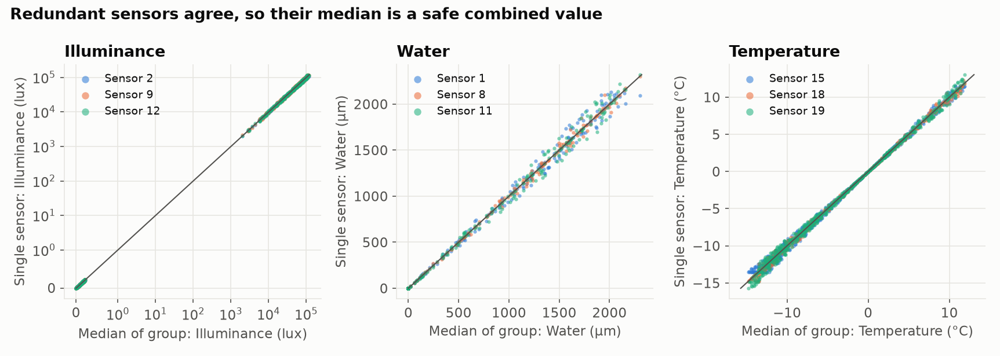
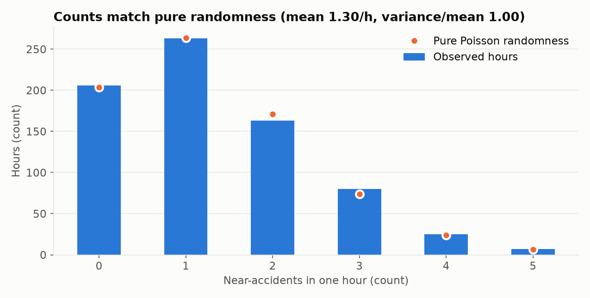
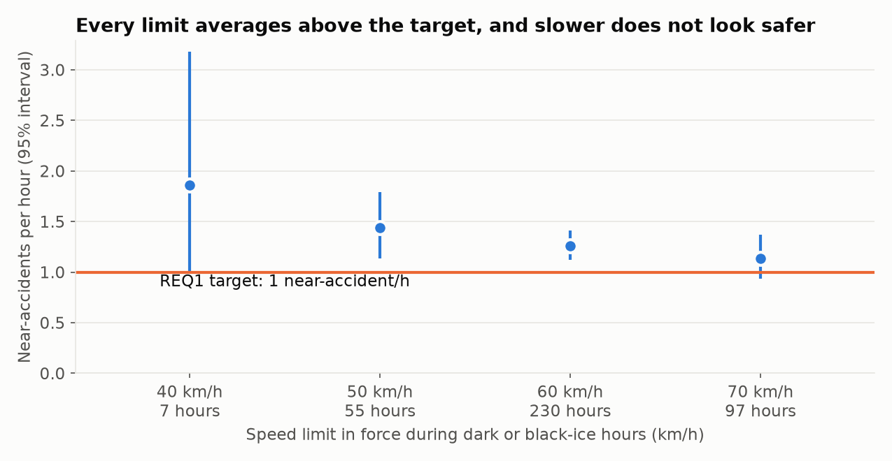
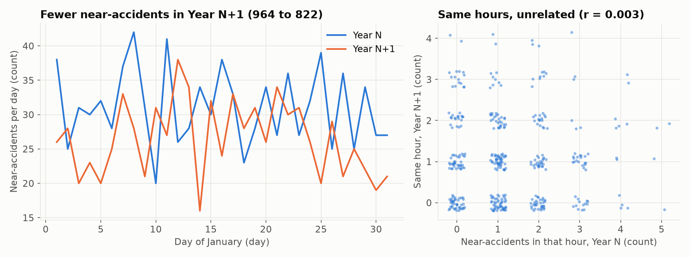

# Data quality report

*Generated by `analyze_data.py`. Training only starts when every hard check below passes.*

**Verdict: fit for training.** The table has one row for each of the 744 hours of January, with no gaps and no impossible values. The data is clean, but it has limited information: see the warnings and plots 6 to 8.

## Validation checks

| Check | Type | Result | Detail |
|---|---|---|---|
| complete_hours | Hard | Pass | 744 of 744 hours |
| unique_hours | Hard | Pass | 0 duplicated hours |
| no_missing_values | Hard | Pass | 0 missing values |
| values_in_range | Hard | Pass | Out of range: none |
| legal_speed_limits | Hard | Pass | 0 hours with an illegal limit (km/h) |
| no_personal_data | Hard | Pass | Personal columns: none |
| labels_valid | Hard | Pass | 0 negative near-accident counts |
| labels_reconcile | Hard | Pass | 964 near-accidents in the table, 964 in the source file |
| redundant_sensors_agree | Hard | Pass | Lowest correlation between redundant sensors: 0.995 |
| only_january | Warning | Attention | All readings are from January, so other seasons are unknown |
| support_per_limit | Warning | Attention | Limits with under 30 hours: {40: 7} |
| years_differ | Warning | Attention | Year N+1 sensor readings are identical to Year N |

## What was found and fixed

The files needed structural repairs. Most value faults listed on slide 17 are not present in the V100 files. Near-accidents: 964, real accidents: 32, empty rows: 1.

## Does the cleaner work?

The real files have few value faults to repair, so this demo injects slide-17 faults into a copy: spikes, invalid months, empty values, missing sensor ids, a missing day and duplicates.

After cleaning, the temperature differs from the clean table by 0.009 °C on average.

| Repair | Count |
|---|---|
| months repaired | 48 |
| rows bad time | 0 |
| rows without sensor | 10 |
| unknown sensor rows | 0 |
| empty values | 60 |
| out of range | 11 |
| duplicates removed | 24 |
| hours filled | 0 |
| cells interpolated | 15 |

## Is the data complete and plausible?

## What the clean data can and cannot tell us

**Near-accidents look random.** Variance/mean is 1.00. A value of 1 is what pure Poisson randomness gives, so there may be little for a model to learn.

**Slower limits do not look safer.** The intervals overlap heavily, and 40 km/h has very few hours. This is noise or confounding, not evidence that slowing down is dangerous.

| Limit (km/h) | Hours | Near-accidents/h | 95% interval (near-accidents/h) |
|---|---|---|---|
| 40 | 7 | 1.86 | 0.99 to 3.18 |
| 50 | 55 | 1.44 | 1.14 to 1.79 |
| 60 | 230 | 1.26 | 1.12 to 1.41 |
| 70 | 97 | 1.13 | 0.93 to 1.37 |

**Year N+1 raises a question.** Its sensor file is identical to Year N, but near-accident counts differ and do not correlate hour by hour.

