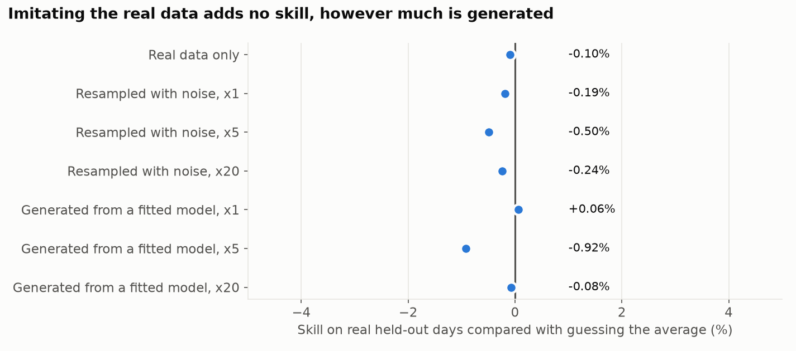
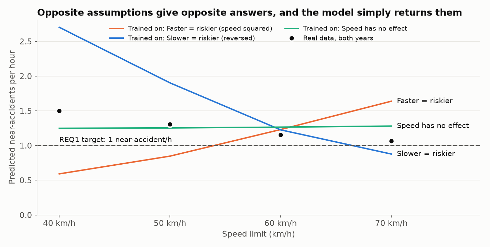

# Synthetic data experiment

*Generated by `synthetic_experiment.py`. This is an experiment only: the production model is not changed.*

**Question:** can generating more data make the network better, or help satisfy REQ1?

**Answer: no.** Data that imitates the real data adds no information. Data with an assumed effect of speed teaches the model that assumption, so its results say nothing about this road.

Every skill figure compares the model with guessing the average. Real results use real held-out days and both years of near-accident labels. Whole days are held out, and synthetic rows come only from training days.

## Experiment 1: imitate the real data

Synthetic hours are real hours with small noise added. Their near-accident counts are either copied, or drawn from a model fitted to the training days.

| Training data | Synthetic rows | Skill on real held-out days |
|---|---|---|
| Real data only | 0 | -0.10% |
| Resampled with noise, x1 | 246 | -0.19% |
| Resampled with noise, x5 | 1233 | -0.50% |
| Resampled with noise, x20 | 4932 | -0.24% |
| Generated from a fitted model, x1 | 246 | +0.06% |
| Generated from a fitted model, x5 | 1233 | -0.92% |
| Generated from a fitted model, x20 | 4932 | -0.08% |

## Experiment 2: assume an effect of speed

Synthetic hours get a random speed limit, and their near-accidents are drawn from an assumed relation between speed and risk. The model trains only on these hours. The policy then runs over all real dark or black-ice hours.

| Assumption built into the data | Skill on synthetic test | Skill on real held-out days | Limits chosen | REQ1 'met' |
|---|---|---|---|---|
| Faster = riskier (speed squared) | +12.81% | -8.23% | 40 km/h: 2 h, 50 km/h: 387 h | 389 of 389 h |
| Slower = riskier (reversed) | +20.64% | -2.46% | 70 km/h: 389 h | 389 of 389 h |
| Speed has no effect | -0.01% | +0.02% | 60 km/h: 389 h | 0 of 389 h |

Predicted near-accidents/h, averaged over the real hours:

| Assumption | 40 km/h | 50 km/h | 60 km/h | 70 km/h |
|---|---|---|---|---|
| Faster = riskier (speed squared) | 0.59 | 0.85 | 1.23 | 1.64 |
| Slower = riskier (reversed) | 2.70 | 1.90 | 1.23 | 0.88 |
| Speed has no effect | 1.25 | 1.25 | 1.26 | 1.28 |
| Real data, both years | 1.50 | 1.31 | 1.15 | 1.07 |

Two opposite assumptions both claim to satisfy REQ1, and they recommend opposite speeds. Each scores well on a test made from its own assumption, yet loses to guessing the average on real days. A score on synthetic data only measures how well the model learned the assumption.

## Where synthetic data is useful

- Testing that the code can learn at all. The control experiment in `tests/test_model.py` does this.
- Demos and stress tests of rare conditions or sensor faults.
- Planning a real trial, by simulating how many hours are needed to detect an effect of a given size.

If published road-safety research is used to set a limit, it should appear as an explicit expert rule with its source, not as training data.
